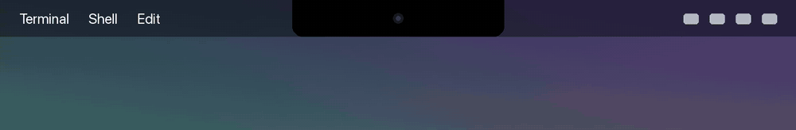
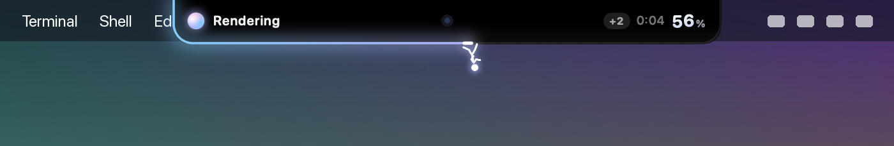
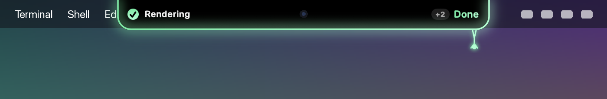
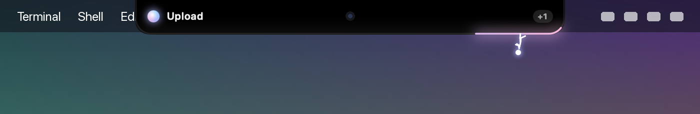
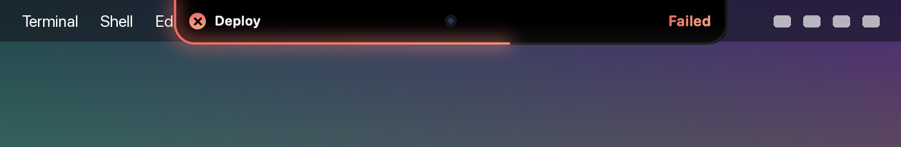

# Agent Island

**Live progress around your Mac's notch — for Claude Code, Codex, and anything else that runs in a terminal.**



When an AI coding agent kicks off a render, a build, a download or a long test run, you usually find out it's finished by staring at a terminal. Agent Island puts that job on the notch instead: what is running, how far along it is, how long is left — and a tiny stick figure jogging upside-down along the progress band so you can tell at a glance that it's still alive.

- **Stays out of the way.** Same height as the notch, click-through, never takes focus, quits itself when nothing is running.
- **Automatic.** A hook puts any shell command that runs longer than 20 s on the island — the agent doesn't have to remember.
- **Real numbers when they exist.** Count output files, parse a log, watch a file grow, or read percentages from a pipe.
- **Agent-agnostic.** One CLI and one JSON file per job. Works from Claude Code, Codex, a Makefile, a cron job, your own script.

| Running | Done |
|---|---|
|  |  |
| **Unknown progress** | **Failed** |
|  |  |

## Install

Requires macOS 14+, the Swift compiler (`xcode-select --install`) and Python 3.8+.

```sh
git clone https://github.com/benrio0923/agent-island.git
cd agent-island && ./install.sh
island demo            # see every state
```

Everything goes into `~/.island`; the CLI is linked to `~/.local/bin/island`. No background daemon, no login item — the app starts when a job is registered and exits 45 s after the last one ends.

### Hook it up to your agent

```sh
island setup claude    # Claude Code: hook in ~/.claude/settings.json, rules in CLAUDE.md, a skill and a subagent
island setup codex     # Codex: hook in ~/.codex/hooks.json, rules in AGENTS.md, a skill
```

Both commands back up the file they touch and only add their own entries. After that:

- any shell command the agent runs for more than 20 s shows up as "still running" and clears itself when it exits;
- the agent is told to register *measured* progress whenever it can (see below), so you get a percentage and an ETA instead of a spinner.

In Claude Code, open `/hooks` once (or restart) so already-running sessions pick the hook up. Codex asks you to trust the new hook the next time it starts. The hook has been exercised mostly on Claude Code; Codex uses the same payload shape — please open an issue if it misbehaves.

## Use it from anything

```sh
# wrap a command — ✓ or ✗ when it exits
island run --title "Build" -- make -j8

# the output already prints percentages
ffmpeg -i in.mov out.mp4 2>&1 | island pipe --title "Export" --regex '(\d+)%'

# the job writes a known number of files
island watch render --title "Render" --dir out/frames --glob '*.png' --total 168

# the log says "step 1200"
island watch train --title "Training" --log train.log --regex 'step (\d+)' --total 5000

# one big file of known size
island watch dl --title "Download" --size model.bin --total 4200000000

# nothing to measure — just show it's alive until the process exits
island watch job --title "Indexing" --pid 12345

# several stages, one after another (queued stages show as "+N")
island watch a --title "Render"  --dir frames --total 168
island watch b --title "Encode"  --log enc.log --regex '(\d+)%' --percent --after a

# or report it yourself
island set job 37/120 --title "Migrating"
island done job            # or: island done job --fail
```

`watch` returns immediately and leaves a tiny watcher (one check per second) that finishes the job at 100 % or when `--pid` exits.

### No CLI? Write a file.

The app only reads `~/.island/jobs/*.json`, so any language can drive it:

```json
{
  "id": "export-42",
  "title": "Export",
  "status": "running",
  "progress": 0.37,
  "current": 37, "total": 100,
  "eta": 95,
  "started": 1763539200.0,
  "updated": 1763539290.0
}
```

`status` is `queued`, `running`, `done` or `failed`; `progress` is 0–1 (negative = unknown); `eta` is seconds; `updated` is a heartbeat — a running job that hasn't been touched for three minutes is shown as paused. Write atomically (temp file + rename). Finished jobs are removed six seconds after they finish.

## Settings

| Environment variable | Effect |
|---|---|
| `ISLAND_HOME` | where jobs and the app live (default `~/.island`) |
| `ISLAND_LANG` | `en` or `zh` for the Done / Failed labels (default: system language) |
| `ISLAND_EAR` | how far the pill extends on each side of the notch, in points (default 122) |
| `ISLAND_NO_RUNNER` | set to hide the stick figure |
| `ISLAND_HOOK_DELAY` | seconds before the hook shows a command (default 20) |

On displays without a notch the island becomes a small capsule under the menu bar.

## How it works

`Sources/Island.swift` is a ~300-line SwiftUI app: a borderless, click-through panel above the menu bar that polls the jobs folder every 0.4 s. `bin/island` is a dependency-free Python script. `hooks/agent_bash_hook.py` is a `PreToolUse` hook: it returns instantly and leaves a detached child that checks, 20 s later, whether the command is still running.

## Uninstall

```sh
island uninstall && rm -rf ~/.island ~/.local/bin/island
```

Then delete the `agent_bash_hook.py` entry from `~/.claude/settings.json` / `~/.codex/hooks.json` and the "Agent Island" section from `CLAUDE.md` / `AGENTS.md`.

## License

MIT © Benrio 班里歐 / OOO.STUDIO. Not affiliated with Apple, Anthropic or OpenAI.

[繁體中文說明](README.zh-TW.md)
